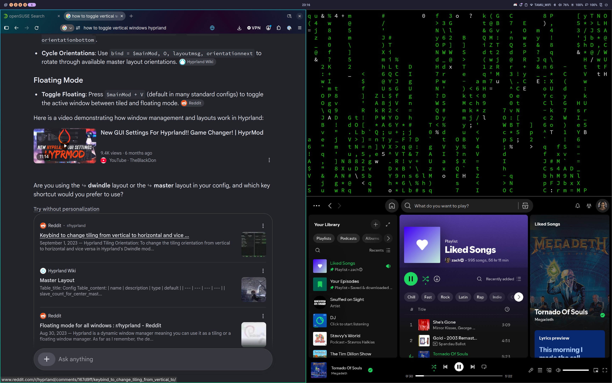
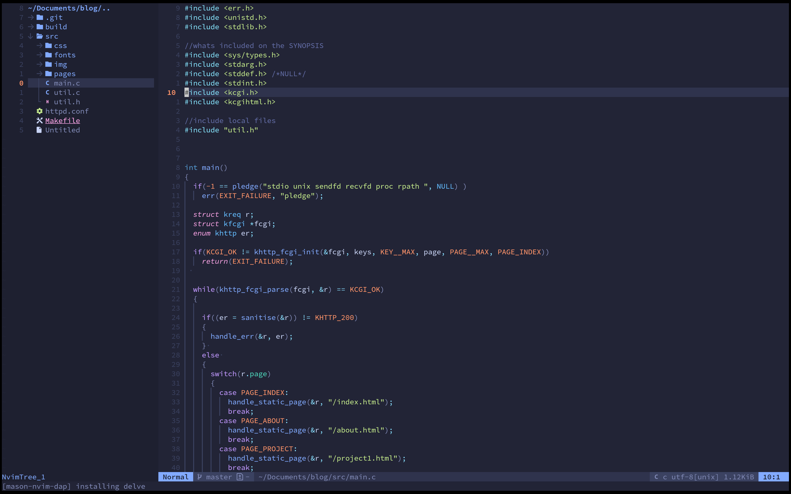
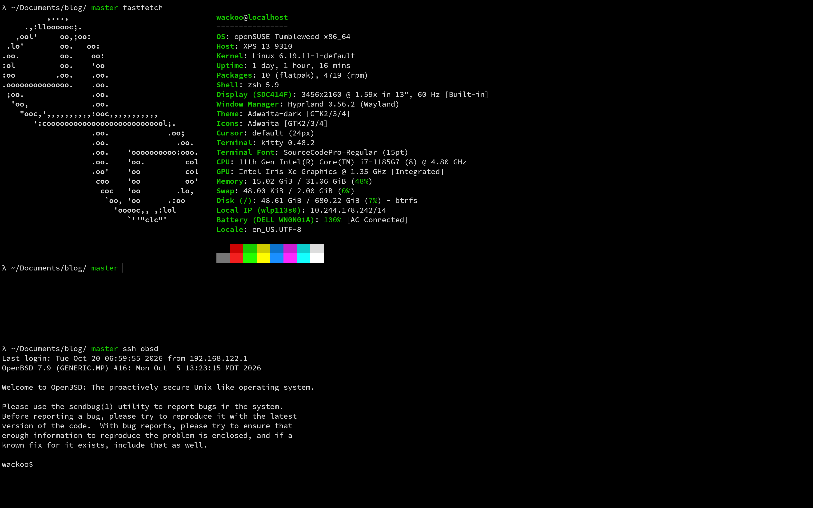

# dotfiles

My Linux desktop config: **Hyprland** (Lua config) with the **Noctalia** shell, **kitty**, **Neovim** (kickstart-based) and **zsh**. Everything is symlinked into `~/.config` with GNU Stow.

## Screenshots



| Neovim | Terminal |
| :---: | :---: |
|  |  |

## What's inside

| Directory | Tool | Notes |
| --- | --- | --- |
| `hypr/` | [Hyprland](https://hypr.land) | `hyprland.lua`, dwindle layout, no gaps or rounding |
| `noctalia/` | [Noctalia](https://github.com/noctalia-dev/noctalia-shell) | bar, battery and wallpaper settings |
| `nvim/` | [Neovim](https://neovim.io) | built on [kickstart.nvim](https://github.com/nvim-lua/kickstart.nvim), `tokyonight-moon` theme, custom plugins go in `lua/custom/plugins/` |
| `kitty/` | [kitty](https://sw.kovidgoyal.net/kitty/) | terminal |
| `zshrc/` | zsh + [Oh My Zsh](https://ohmyz.sh) | `lambda` theme, `git` plugin |

Apps started with Hyprland: `noctalia`, `dunst`, `hyprpolkitagent`, and `cliphist` (via `wl-paste`) for clipboard history.

## Install

```sh
git clone git@github.com:wackooswami/dotfiles.git ~/dotfiles
cd ~/dotfiles
./setup.sh
```

`setup.sh` installs GNU Stow if it's missing (works with emerge, apt, dnf, pacman, zypper and brew), removes broken symlinks, and links each folder to `~/.config/<folder>`.

```sh
./setup.sh hypr nvim   # link only these
./setup.sh -n          # dry run
./setup.sh -D          # remove the links
```

If a folder fails to link, a real file is probably already in `~/.config/<folder>`. Back it up or delete it, then run the script again.

> `zshrc/.zshrc` gets linked to `~/.config/zshrc/.zshrc`. To use it, point `~/.zshrc` at it (`ln -s ~/.config/zshrc/.zshrc ~/.zshrc`) or set `ZDOTDIR`.

## Keybinds

`SUPER` is the main modifier.

| Keys | Action |
| --- | --- |
| `SUPER + Q` | Open kitty |
| `SUPER + R` | Noctalia launcher |
| `SUPER + E` | Open Thunar |
| `SUPER + C` | Close window |
| `SUPER + V` | Toggle floating |
| `SUPER + F` | Toggle fullscreen |
| `SUPER + P` | Pseudotile |
| `SUPER + H/J/K/L` | Move focus |
| `SUPER + 1-0` | Switch workspace |
| `SUPER + SHIFT + 1-0` | Move window to workspace |
| `SUPER + S` / `SUPER + SHIFT + S` | Toggle / send to scratchpad |
| `SUPER + Print` | Screenshot an area (saved to `~/Pictures/screenshots`, copied to clipboard) |
| `SUPER + M` | Exit Hyprland |
| `SUPER + drag` | Move (left click) / resize (right click) windows |
